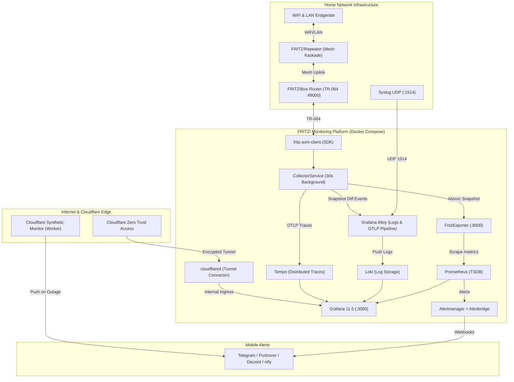

<div align="center">

# 🌐 FRITZ!Box Enterprise Observability & NOC Stack

[](https://github.com/domehahn/fritz.box-monitoring/actions/workflows/ci.yml)
[](https://www.python.org/)
[](https://docs.docker.com/compose/)
[](https://grafana.com/)
[](https://prometheus.io/)
[](https://grafana.com/oss/loki/)
[](https://grafana.com/oss/tempo/)
[](https://grafana.com/docs/alloy/)
[](https://developers.cloudflare.com/cloudflare-one/)

**Production-grade, end-to-end network operations center (NOC) and telemetry pipeline for AVM FRITZ!Box routers, mesh repeaters, and connected smart home environments.**

[Features](#-key-features) • [Architecture](#-architecture) • [Dashboards](#-provisioned-dashboards) • [Quick Start](#-quick-start) • [Cloudflare Access](#-secure-remote-access-via-cloudflare-zero-trust) • [Documentation](#-documentation)

</div>

---

## ⚡ Key Features

* **Full Grafana LGTM Telemetry Stack**:
  * **Metrics**: Prometheus (TSDB) & VictoriaMetrics (long-term archive).
  * **Logs**: Loki with Syslog UDP (RFC3164) ingestion via Grafana Alloy.
  * **Traces**: Distributed tracing with Grafana Tempo via OpenTelemetry OTLP.
  * **Correlation**: 1-click navigation between Loki logs and Tempo trace waterfalls (`trace_id`).
* **Deep Mesh Topology & Link Diagnostics**:
  * **Repeater Inventory**: Permanent tracking of all mesh nodes; detect powered-off or unplugged repeaters (`fritz_mesh_node_online == 0`) with exact timestamps rather than stale disappearing metrics.
  * **Multi-Hop Hierarchy**: Automatic depth tracking (`hop_count`), medium identification (`LAN Gigabit`, `5 GHz`, `2.4 GHz`, `Powerline`), and link quality ratios.
  * **Root-Cause Analysis Engine**: Automated diagnosis for band downgrades, backhaul saturation, weak client RSSI, and sticky clients.
* **Wi-Fi Spectrum & Interference Tracking**:
  * Real-time channel load (%), non-Wi-Fi interference, channel width (20–160 MHz), and DFS radar wait monitoring.
* **Secure Remote Access with Cloudflare Zero Trust**:
  * Outbound-only Cloudflare Tunnel (`cloudflared`) — **no port forwarding, no router firewall changes**.
  * Identity verification via Cloudflare Access (Email OTP, Google/GitHub OAuth, 2FA) and automatic Grafana Single Sign-On (Auth-Proxy).
* **External Synthetic Outage Monitor**:
  * Standalone Cloudflare Worker executing global edge health checks every minute; instantly alerts your phone if home power or ISP fails from the outside.
* **Multi-Channel Push Notifications**:
  * Rich mobile alerts via **Telegram**, **Pushover**, **Discord Webhooks**, and **ntfy.sh** for network outages, mesh flaps, and critical links.
* **ISP SLA & Quality Audit**:
  * 30-day contract fulfillment ratios, bufferbloat grade, latency-under-load analysis, and dispute protocols for ISP complaint submissions.
* **Self-Healing & Remediation**:
  * Automated smart-plug power-cycles for frozen repeaters and idle guest Wi-Fi deactivation.
* **Supply Chain Hardening**:
  * All containers non-root, dropped Linux capabilities (`cap_drop: ALL`), Docker Secrets, read-only filesystems, and reproducible multi-stage builds.

---

## 🏗 Architecture



---

## 📊 Provisioned Dashboards

All dashboards are pre-configured in [config/grafana/provisioning/dashboards_files/](file:///Users/dominikhahn/dev/workspace/fritz.box-monitoring/config/grafana/provisioning/dashboards_files/):

| UID | Dashboard | Description |
|---|---|---|
| `fritz_noc` | **Home Network NOC** | High-level operations center: WAN throughput & utilization, client count, stability, and mesh health. |
| `fritz_mesh_diag` | **Deep Mesh & Link Diagnostics** | **100% Root-Cause Visibility**: Repeater inventory (online vs. unpowered), multi-hop hierarchy, link speeds, band fallbacks, and correlated Loki logs/Tempo traces. |
| `isp_sla_report` | **ISP SLA & Quality Audit** | Contract fulfillment ratio (30d), bufferbloat latency-under-load analysis, and dispute protocols for ISP speed complaints. |
| `fritz_mesh` | **Mesh Infrastructure** | Repeater Health Matrix, live node graph topology, node state timeline, and backhaul baselines. |
| `fritz_client` | **Client Diagnostics** | Deep-dive for individual devices (`$device`): Access point assignment, PHY speed, Wi-Fi signal, and traffic volume. |
| `fritz_probes` | **Network Path Probes** | Active latency, jitter, and packet loss measurements per hop (LAN → WAN Gateway → Cloudflare/Google DNS). |
| `fritz_events` | **Network Events & Forensics** | Structured audit log of connects, disconnects, mesh roaming, and IP address changes. |

---

## 🚀 Quick Start

### 1. Create Secrets
```bash
mkdir -p secrets
echo "my_fritz_password" > secrets/fritz_password.txt
echo "my_grafana_password" > secrets/grafana_admin_password.txt
echo "my_device_manager_password" > secrets/device_manager_admin_password.txt
chmod 600 secrets/*
```

### 2. Configure Environment
```bash
cp .env.production.example .env.production
```
*(Optionally set your push notification tokens for Telegram, Pushover, Discord, or ntfy in `.env.production`)*

### 3. Launch Stack
```bash
docker compose --env-file .env.production -f compose.prod.yml up -d
```
Access Grafana locally at **`http://127.0.0.1:3000`** (User: `admin`, Password: from `secrets/grafana_admin_password.txt`).

---

## ☁️ Secure Remote Access via Cloudflare Zero Trust

Access your dashboards from anywhere in the world without opening ports on your home router:

1. **Run Setup Helper**:
   ```bash
   ./scripts/setup-cloudflare-tunnel.sh
   ```
2. **Launch with Cloudflare Profile**:
   ```bash
   docker compose --env-file .env.production -f compose.prod.yml --profile cloudflare up -d
   ```
3. For detailed instructions on Zero Trust Access policies and SSO, see the [Cloudflare Zero Trust Guide](docs/CLOUDFLARE_ZERO_TRUST.md).
4. To enable external outage monitoring from the edge, see the [Cloudflare Synthetic Monitor Guide](docs/CLOUDFLARE_SYNTHETIC_MONITOR.md).

---

## 📚 Documentation

### Operations & Guides
* 📖 [Architecture Documentation](docs/ARCHITECTURE.md)
* ☁️ [Cloudflare Zero Trust Setup](docs/CLOUDFLARE_ZERO_TRUST.md)
* 🛰️ [External Synthetic Outage Monitor](docs/CLOUDFLARE_SYNTHETIC_MONITOR.md)
* 📊 [Dashboards & Alerting Guide](docs/dashboards.md)
* 📋 [Metric Catalogue](docs/fritz-metrics.md)
* 🔐 [FRITZ!Box User Permissions](docs/fritz-permissions.md)
* 🛠️ [Troubleshooting Playbook](docs/troubleshooting.md)
* 🔒 [Security & Threat Model](docs/SECURITY.md)
* 💾 [Backup & Restore Guide](docs/BACKUP_RESTORE.md)

### Optional Profiles
* `--profile iperf`: Active LAN reference probe against wired `iperf3` servers.
* `--profile smarthome`: Exporters for Philips Hue, Bosch Smart Home, Blink, and FRITZ!DECT.
* `--profile speedtest`: Scheduled WAN bandwidth tests against Ooklia / Cloudflare.
* `--profile bufferbloat`: Real-time latency-under-load measurement.
* `--profile pihole` / `--profile adguard`: DNS sinkhole & adblocking security exporters.
* `--profile automation`: Automated self-healing and smart home remediation.

---

## 🛡️ Security & Hardening

* **Least Privilege**: The exporter requires only read permissions (*"FRITZ!Box Einstellungen"*).
* **Container Hardening**: All services run as unprivileged users (`cap_drop: ALL`, `no-new-privileges: true`).
* **Zero Open Inbound Ports**: Remote access relies entirely on outbound TLS 1.3 / QUIC tunnels via Cloudflare.
* **Secret Management**: Passwords and tokens are mounted strictly via Docker Secrets (RAM tmpfs).

---

## 📄 License & Attribution

Maintained by Dominik Hahn. Open-source under standard project terms.

